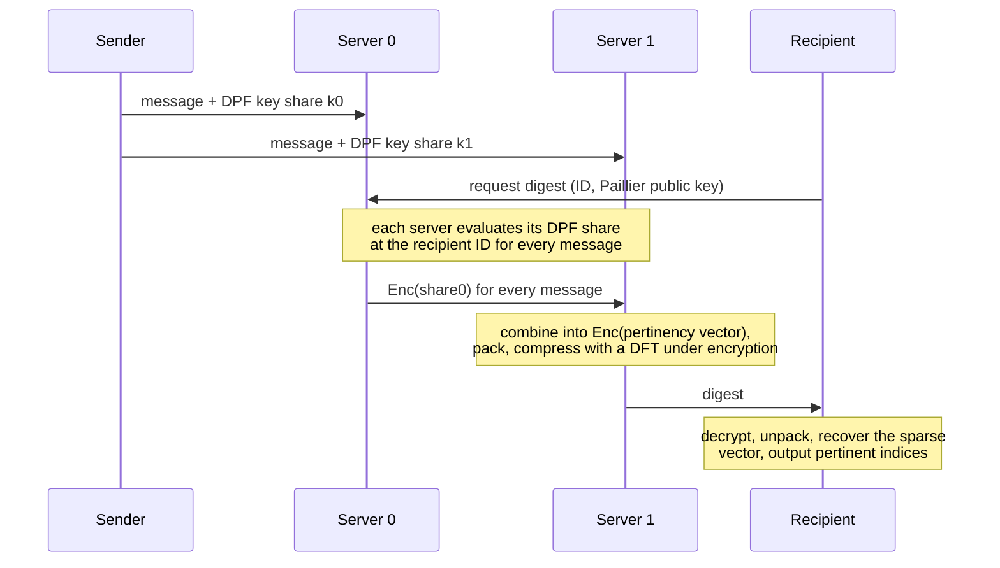

# Bandwidth-Efficient Multi-Server Oblivious Message Retrieval

A C++ implementation and benchmarking environment for a two-server Oblivious Message Retrieval (OMR) protocol, developed as part of my Master's thesis.

**Master's thesis**, [Applied Cryptography Group](https://appliedcrypto.ethz.ch), Institute of Information Security, Department of Computer Science, ETH Zurich. Submitted January 2025.<br/>
**Advisors:** Prof. Kenny Paterson, Laura Hetz

OMR lets a recipient find and fetch the messages addressed to them from a public bulletin board while the servers learn nothing about which messages belong to whom. When the thesis was submitted in January 2025, this protocol had the lowest bandwidth of any published OMR scheme, with public keys of about 1 kB where previous schemes needed more than 100 MB.

## Motivation

End-to-end encryption protects what a message says. It does not hide who talks to whom. Prior work covers sender anonymity in depth, but recipient anonymity remains open: a server that delivers a message learns its recipient.

Earlier OMR protocols focused on cutting client and server computation. Their bandwidth and key sizes can still make them impractical to deploy. This thesis targets those two costs.

## Results

Numbers from the thesis evaluation. All comparisons are against OMR schemes published before the thesis was submitted in January 2025. Detection identifies which messages are pertinent; full retrieval pairs detection with a PIR scheme to fetch them.

| Metric | This protocol | Compared to prior work (as of January 2025) |
| --- | --- | --- |
| Detection digest, 50 pertinent messages out of 2<sup>19</sup> | 24.6 kB | 5.3× smaller than other detection protocols |
| Full OMR bandwidth (detection + PIR) | | 2.2× smaller than previous OMR schemes |
| Server runtime to compute the digest | | 2× faster than the next best HE-based OMR scheme |
| Recipient public key | ~1 kB | previous schemes: over 100 MB |

## How it works

The protocol combines two non-colluding, semi-honest servers, distributed point functions (DPFs), and the additively homomorphic Paillier cryptosystem.



1. **Send.** The sender generates a DPF for the point function that outputs 1 at the recipient's ID, and posts the message to both servers with one key share each. Each share alone reveals nothing about the recipient.
2. **Evaluate.** For every message, each server evaluates its DPF share at the querying recipient's ID. The two outputs are XOR shares of a bit that says whether the message is pertinent.
3. **Combine under encryption.** Server 0 encrypts its shares under the recipient's Paillier key and sends them to Server 1, which combines them homomorphically with its own shares. The result is an encrypted pertinency vector that neither server can read.
4. **Pack.** Many plaintext slots go into each 4096-bit Paillier ciphertext so that several DFTs run in parallel. A Lambert W estimate picks the packing factor, and a balls-into-bins bound fixes how many pertinent messages each slot must handle so that a slot overflows with probability below 2<sup>-40</sup>.
5. **Compress.** The pertinency vector is sparse. For each slot, Server 1 evaluates the first few coefficients of its discrete Fourier transform over a prime field under encryption, twice as many as the per-slot bound from step 4. These coefficients form the digest.
6. **Decode.** The recipient decrypts and unpacks the digest, solves a Toeplitz system for the linear recurrence of the coefficients, extends them to the full spectrum with Blahut's theorem, and applies the inverse DFT to obtain the pertinent indices.

## Security model and limitations

**Threat model.** The two servers are semi-honest and do not collude. Under these assumptions neither server, nor a network observer, learns which messages are pertinent to a recipient.

What the protocol does not cover:

- **Collusion.** Two colluding servers can reconstruct every DPF and learn each message's recipient.
- **Malicious servers.** A server that deviates from the protocol can corrupt the digest. The recipient has no way to detect this.
- **Detection failure.** Detection can fail with probability at most 2<sup>-40</sup> when one packed slot receives more pertinent messages than the parameters allow.
- **Client-side timing.** The decoder skips DFT slots with no pertinent messages ([src/omd.cpp](src/omd.cpp), `decodeDigest`). This speeds up decoding but leaks information about *k* to anyone who can measure the recipient's decoding time. A deployment would decode every slot.

What this implementation is:

- A research prototype. Both servers, the sender, and the recipient run in one process with no networking, and message payloads are dummy data.
- The workload generator uses `std::mt19937` to choose random recipients. All cryptographic randomness comes from dpf-cpp and ophelib.
- The code has not been audited. Do not use it to protect real communication.

## Building

The build requires an x86-64 CPU with AES-NI and AVX2, because dpf-cpp uses those instructions.

### Docker (recommended)

The Dockerfile installs all dependencies on Ubuntu 22.04.

```sh
docker build -t bems-omr .                 # add --platform linux/amd64 on Apple Silicon
docker run -it bems-omr bash               # same flag here

# inside the container
cmake -B build -S . -DCMAKE_BUILD_TYPE=Release
cmake --build build
./build/run -N 4096 -M 22 -K 2
```

### Manual

On Ubuntu 22.04:

1. Install `build-essential cmake git libgmp-dev libssl-dev libgsl-dev m4 libtool-bin libntl-dev`.
2. Clone and build [dpf-cpp](https://github.com/dkales/dpf-cpp) at `/usr/src/dpf-cpp`, the path `CMakeLists.txt` expects.
3. Clone, build, and install [ophelib](https://github.com/abb-iss/ophelib).
4. Build this project with the commands above.

The [Dockerfile](Dockerfile) runs exactly these steps.

## Usage

```
./run -N <messages> -M <log users> -K <pertinent> [-R]
./run -B [-R]
```

| Flag | Meaning |
| --- | --- |
| `-N` | Number of messages on the bulletin board |
| `-M` | Log2 of the number of users (5 to 30) |
| `-K` | Number of messages pertinent to the retrieving user (1 to N) |
| `-R` | Run full retrieval (OMR) instead of detection (OMD) |
| `-B` | Run the benchmark suite defined in [src/run.cpp](src/run.cpp) and append results to `benchmark.csv` |
| `-h` | Show usage |

Each run generates a random bulletin board, executes the protocol, and checks the decoded indices against the ground truth. The program exits with status 1 if they differ.

Example output:

```
$ ./run -N 4096 -M 22 -K 2
OMD
Sending of Messages done. It took 0.0115428 seconds.
Server Precomputations done. It took 0.00608929 seconds.
Server Retrieval done. It took 4.20463 seconds.
Client Decoding done. It took 0.0419439 seconds.
Digest Size: 6144 bytes.
PK Size: 1023 bytes.
Result is correct.
```

**Parameter range.** Detection requires `K * N >= 7714` with the default 2048-bit Paillier primes, because the packing factor estimate is undefined below that bound. Close to the bound the packing degenerates and runs can fail (for example `-N 2000 -K 4`). Runs with `-N 4096 -K 2` and larger pass.

## Repository layout

| Path | Contents |
| --- | --- |
| [src/omd.cpp](src/omd.cpp) | Detection protocol: sender, servers, packing, encrypted DFT, recipient decoding |
| [src/omr.cpp](src/omr.cpp) | Retrieval variant that compresses message payloads into the digest |
| [src/run.cpp](src/run.cpp) | Simulation driver and benchmark suite |
| [src/main.cpp](src/main.cpp) | Command-line interface |
| [src/packing_utility.hpp](src/packing_utility.hpp) | Packing factor estimate (Lambert W) and slot unpacking |
| [src/mod_utility.hpp](src/mod_utility.hpp) | Modular arithmetic, roots of unity, Toeplitz system solver |
| [src/prime_utility.hpp](src/prime_utility.hpp) | Prime search for the DFT modulus |
| [cmake/](cmake/) | Find modules that ophelib's installed package config requires (taken from ophelib, BSD-3-Clause) |

## Acknowledgements

- [dpf-cpp](https://github.com/dkales/dpf-cpp) by Daniel Kales for distributed point functions
- [ophelib](https://github.com/abb-iss/ophelib) by ABB for Paillier encryption and ciphertext packing

## Citation

```bibtex
@mastersthesis{teichner2025omr,
  author = {Moritz Teichner},
  title  = {Bandwidth-Efficient Multi-Server Oblivious Message Retrieval},
  school = {ETH Zurich},
  year   = {2025},
  month  = jan,
  type   = {Master's thesis}
}
```
